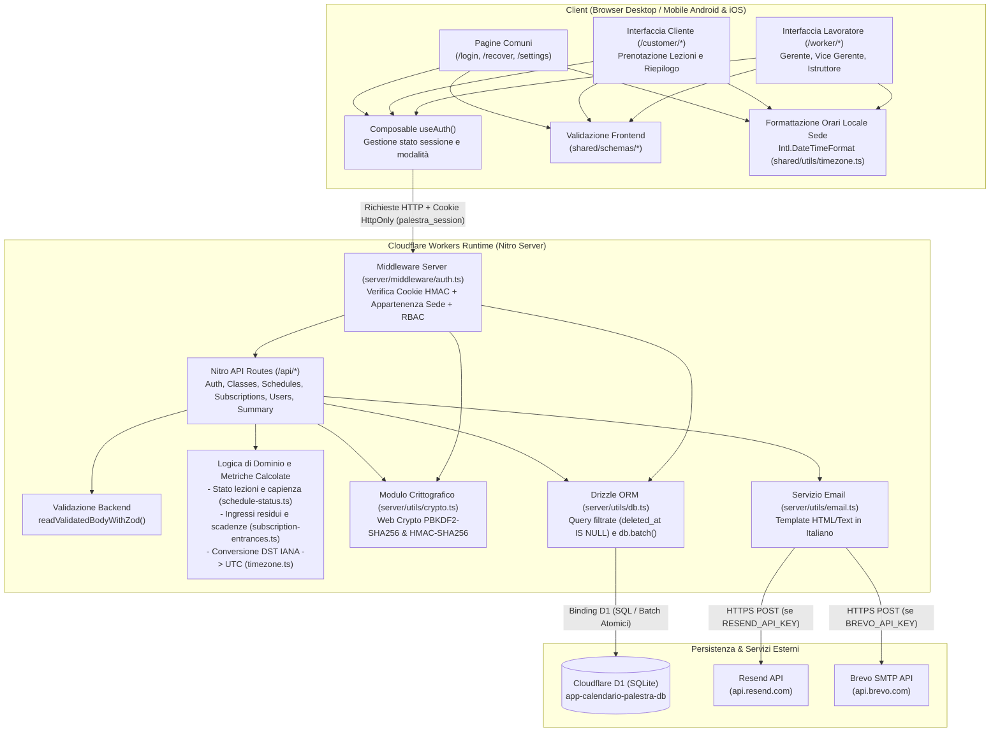
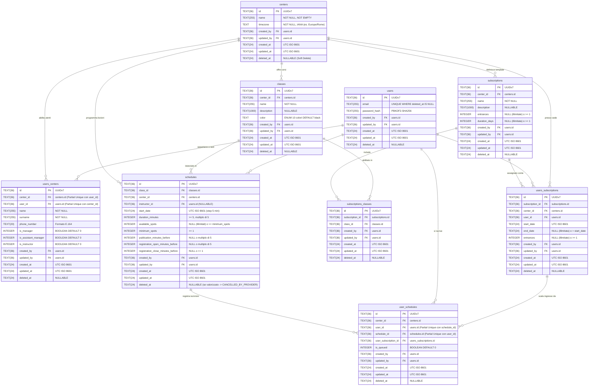

# 01 - Architettura e Sviluppo

**Progetto:** `app-calendario-palestra` (Calendario Palestra)  
**Destinatari:** Team di Sviluppo, Software Architect, Manutentori Tecnici  
**Ultimo aggiornamento:** 17/11/2026  
**Referente Tecnico Consegna:** `[DA COMPLETARE: Nome e contatto del referente tecnico di sviluppo]`

---

## 1. Panoramica Architetturale

L'applicazione **Calendario Palestra** è una piattaforma web multi-sede e multi-ruolo progettata per la gestione di corsi di gruppo, calendari lezioni, abbonamenti a ingressi o illimitati, iscrizioni con gestione automatica della lista d'attesa (coda) e comunicazioni email transazionali.

Il sistema è sviluppato come applicazione full-stack **Nuxt 4** (Vue 3 Composition API + Nitro Server) compilata per l'esecuzione **Edge** su **Cloudflare Workers** e abbinata al database relazionale serverless **Cloudflare D1** (basato su SQLite).

### 1.1 Stack Tecnologico

| Livello | Tecnologia | Versione (Risolta) | Ruolo nel Sistema |
| :--- | :--- | :--- | :--- |
| **Framework Full-Stack** | Nuxt | `4.6.4` | Rendering ibrido/SSR, routing file-based, gestione stato e backend Nitro |
| **UI Library & Routing** | Vue / Vue Router | `3.5.45` / `5.5.0` | Componenti reattivi `<script setup lang="ts">`, layout e navigazione |
| **Styling** | Tailwind CSS (`@nuxtjs/tailwindcss`) | `6.14.0` | Design responsive mobile-first (desktop, Android, iOS) |
| **Server & Edge Runtime** | Nitro (`cloudflare-module`) | Integrato in Nuxt 4 | Esecuzione API serverless su Cloudflare Workers (`compatibility_date: 2025-07-15`) |
| **Database** | Cloudflare D1 (SQLite) | Binding `DB` | Persistenza relazionale multi-centro con supporto batch atomici |
| **ORM & Migrazioni** | Drizzle ORM / Drizzle Kit | `0.45.4` / `0.31.11` | Query builder type-safe, schema definition e generazione migrazioni SQL |
| **Validazione Dati** | Zod | `4.6.7` | Validazione isomorfica condivisa tra form frontend ed endpoint backend |
| **Identificativi Univoci** | `uuidv7` | `1.2.1` | Generazione chiavi primarie `CHAR(36)` ordinate temporalmente (UUIDv7) |
| **Crittografia** | Web Crypto API (`crypto.subtle`) | Nativa Edge / V8 | Hashing password (`PBKDF2-SHA256`) e firma token stateless (`HMAC-SHA256`) |
| **Email Transazionali** | Fetch HTTP verso Resend / Brevo | REST API v1 / v3 | Invio email in italiano con fallback automatico su console/outbox in sviluppo |
| **Testing** | Vitest | `5.1.0` | Suite di test unitari, d'integrazione DB e flussi end-to-end API |

### 1.2 Diagramma di Architettura e Flusso Dati



---

## 2. Architecture Decision Records (ADR)

La seguente tabella riassume le scelte architetturali fondamentali dedotte dal codebase, con le relative motivazioni e i compromessi (trade-off) accettati.

| ID | Decisione Architetturale | Motivazione | Compromessi / Implicazioni | Riferimenti Codice |
| :--- | :--- | :--- | :--- | :--- |
| **ADR-001** | **Esecuzione su Cloudflare Workers (`cloudflare-module`) senza dipendenze C++ native** | Garantire latenza ridotta, scalabilità serverless a costo contenuto e piena compatibilità con l'infrastruttura Cloudflare D1. | Impossibilità di usare librerie Node.js basate su addon nativi (es. `bcrypt` C++ o `fs` a runtime). Tutta la crittografia usa `crypto.subtle` standard Web API. | [nuxt.config.ts](file:///c:/Users/Damiano/Progetti%20Visual%20Studio%20Code/app-calendario-palestra/nuxt.config.ts), [wrangler.jsonc](file:///c:/Users/Damiano/Progetti%20Visual%20Studio%20Code/app-calendario-palestra/wrangler.jsonc) |
| **ADR-002** | **Soft Delete rigoroso (`deleted_at`) e Indici Parziali Univoci** | Preservare lo storico completo per audit (`created_by`, `updated_by`, `deleted_at`), gestire l'annullamento lezioni (`CANCELLED_BY_PROVIDER`) e impedire perdite accidentali di dati senza `ON DELETE CASCADE`. | Ogni query `SELECT` deve filtrare esplicitamente `isNull(table.deletedAt)`. L'univocità su record attivi è garantita tramite indici parziali SQLite (`WHERE deleted_at IS NULL`). | [server/db/schema.ts](file:///c:/Users/Damiano/Progetti%20Visual%20Studio%20Code/app-calendario-palestra/server/db/schema.ts) |
| **ADR-003** | **Campi di stato e contatori calcolati dinamicamente a runtime (mai salvati su DB)** | Evitare disallineamenti (stati incoerenti per il passare del tempo o contatori disallineati) per `schedules.status`, `enrolled_count`, `remaining_spots` e `users_subscriptions.remaining_entrances`. | Richiede il caricamento delle righe attive di `user_schedules` collegate e il ricalcolo in memoria tramite helper puri (`attachComputedScheduleMetrics`, `attachComputedUserSubscriptionMetrics`). | [shared/utils/schedule-status.ts](file:///c:/Users/Damiano/Progetti%20Visual%20Studio%20Code/app-calendario-palestra/shared/utils/schedule-status.ts), [shared/utils/subscription-entrances.ts](file:///c:/Users/Damiano/Progetti%20Visual%20Studio%20Code/app-calendario-palestra/shared/utils/subscription-entrances.ts) |
| **ADR-004** | **Sessione e Token di Recupero Password completamente Stateless (HMAC-SHA256)** | Eliminare la necessità di tabelle di sessione o di token di reset nel database, riducendo le scritture su D1. | Il token di recupero password (valido 30 min) include gli ultimi 8 caratteri di `password_hash` (`pht`): non appena la password viene cambiata, il token diventa automaticamente inutilizzabile (monouso). | [server/utils/crypto.ts](file:///c:/Users/Damiano/Progetti%20Visual%20Studio%20Code/app-calendario-palestra/server/utils/crypto.ts), [server/utils/auth.ts](file:///c:/Users/Damiano/Progetti%20Visual%20Studio%20Code/app-calendario-palestra/server/utils/auth.ts) |
| **ADR-005** | **Gestione date in UTC ISO 8601 (`CHAR(24)`) e conversione DST-aware sul fuso IANA della sede** | Evitare errori dovuti al cambio ora solare/legale (DST) durante la generazione di lezioni ricorrenti e mostrare sempre agli utenti l'orario locale della palestra fisica, indipendentemente dal fuso del dispositivo client. | In scrittura l'offset IANA viene calcolato sulla specifica data futura della lezione (`localDateTimeToUtcIso`); in lettura si usa sempre `Intl.DateTimeFormat('it-IT', { timeZone: center.timezone })`. | [shared/utils/timezone.ts](file:///c:/Users/Damiano/Progetti%20Visual%20Studio%20Code/app-calendario-palestra/shared/utils/timezone.ts) |
| **ADR-006** | **Validazione condivisa con Zod 4 e disattivazione auto-import `shared/` di Nuxt** | Replicare esattamente i vincoli di business e del database sia nei form Vue sia nelle API Nitro, mantenendo un'unica fonte di verità in `shared/schemas/*`. | In `nuxt.config.ts` è impostato `dir: { shared: 'shared_unused' }` per evitare conflitti di auto-importazione di Nuxt 4; i moduli in `shared/` vengono importati esplicitamente. | [nuxt.config.ts](file:///c:/Users/Damiano/Progetti%20Visual%20Studio%20Code/app-calendario-palestra/nuxt.config.ts), [shared/schemas/index.ts](file:///c:/Users/Damiano/Progetti%20Visual%20Studio%20Code/app-calendario-palestra/shared/schemas/index.ts) |
| **ADR-007** | **Concorrenza e atomicità tramite `db.batch()` di Cloudflare D1** | Garantire l'integrità dei dati nelle operazioni multi-statement (creazione lezioni ricorrenti, creazione abbonamento + corsi, iscrizione/disiscrizione con promozione automatica dalla coda). | Cloudflare D1 esegue gli array passati a `db.batch([...])` in una singola transazione SQLite sequenziale. | [server/api/schedules/[id]/enroll.post.ts](file:///c:/Users/Damiano/Progetti%20Visual%20Studio%20Code/app-calendario-palestra/server/api/schedules/%5Bid%5D/enroll.post.ts), [server/api/schedules/[id]/enroll/[userId].delete.ts](file:///c:/Users/Damiano/Progetti%20Visual%20Studio%20Code/app-calendario-palestra/server/api/schedules/%5Bid%5D/enroll/%5BuserId%5D.delete.ts) |

---

## 3. Struttura del Repository e Convenzioni

### 3.1 Albero delle Directory

```text
app-calendario-palestra/
├── app/                                # Frontend Nuxt 4 (Vue 3 Composition API)
│   ├── components/                     # Componenti UI riutilizzabili
│   │   ├── customer/
│   │   │   └── UserCourseCard.vue      # Card corso cliente a 4 righe con modale abbonamenti
│   │   ├── worker/
│   │   │   ├── ClassForm.vue           # Form creazione/modifica/eliminazione corso
│   │   │   ├── ScheduleForm.vue        # Form lezioni, lista iscritti/coda e invio email
│   │   │   ├── SubscriptionForm.vue    # Form template abbonamento e associazione corsi
│   │   │   └── UserForm.vue            # Form anagrafica/ruoli utente, reset password, email
│   │   ├── ClassColorBadge.vue         # Badge visivo colore corso
│   │   ├── ConfirmDialog.vue           # Modale di conferma azioni distruttive
│   │   ├── CustomerNavbar.vue          # Navbar responsiva modalità Cliente
│   │   ├── ScheduleStatusBadge.vue     # Badge stato lezione (DRAFT..CANCELLED)
│   │   └── WorkerNavbar.vue            # Navbar responsiva modalità Lavoratore
│   ├── composables/
│   │   └── useAuth.ts                  # Stato autenticazione, sede attiva, ruoli e switch modalità
│   ├── layouts/
│   │   ├── customer.vue                # Layout area Cliente
│   │   └── worker.vue                  # Layout area Lavoratore
│   ├── middleware/
│   │   ├── auth-client.ts              # Guardia client per rotte autenticate (/settings)
│   │   ├── customer.ts                 # Guardia client per rotte /customer/*
│   │   └── worker.ts                   # Guardia client per /worker/* + sola lettura Istruttori
│   ├── pages/                          # Pagine e routing file-based
│   │   ├── customer/
│   │   │   ├── index.vue               # Dashboard cliente (lista giornaliera lezioni)
│   │   │   └── summary.vue             # Riepilogo cliente (lezioni attive/annullate, abbonamenti)
│   │   ├── worker/
│   │   │   ├── classes/                # Lista, creazione (/new) e dettaglio (/[id]) corsi
│   │   │   ├── schedules/              # Lista, creazione (/new) e dettaglio (/[id]) lezioni
│   │   │   ├── subscriptions/          # Lista, creazione (/new) e dettaglio (/[id]) abbonamenti
│   │   │   ├── user-subscriptions/     # Lista e gestione sottoscrizioni (?user=userId)
│   │   │   ├── users/                  # Lista, creazione (/new) e dettaglio (/[id]) clienti
│   │   │   ├── calendar.vue            # Calendario griglia settimanale/mensile (desktop) e giornaliera (mobile)
│   │   │   └── index.vue               # Dashboard lavoratore con 4 azioni rapide
│   │   ├── index.vue                   # Redirect iniziale in base al ruolo (defaultRedirect)
│   │   ├── login.vue                   # Schermata di autenticazione
│   │   ├── recover.vue                 # Richiesta recupero password e reset con token
│   │   └── settings.vue                # Cambio sede attiva, cambio password e logout
│   ├── utils/
│   │   └── ui-formatters.ts            # Stili colori/stati, formattatori ore/minuti ed estrattore errori API
│   └── app.vue                         # Root component Nuxt
├── public/                             # Asset statici pubblici (favicon.ico, robots.txt)
├── server/                             # Backend Nitro (Cloudflare Workers)
│   ├── api/                            # Endpoint REST sotto /api/*
│   │   ├── auth/                       # login.post, logout.post, me.get, recover.post, reset-password.post
│   │   ├── classes/                    # index.get, index.post, [id].get, [id].put, [id].delete
│   │   ├── customer/                   # summary.get
│   │   ├── schedules/                  # index.get, index.post, [id].get, [id].put, [id].delete,
│   │   │                               # [id]/email.post, [id]/enroll.post, [id]/enroll/[userId].delete
│   │   ├── settings/                   # center.put, password.put
│   │   ├── subscriptions/              # index.get, index.post, [id].get, [id].put, [id].delete
│   │   ├── user-subscriptions/         # index.get, index.post, [id].put, [id].delete
│   │   └── users/                      # index.get, index.post, email.post, [id].get, [id].put,
│   │                                   # [id].delete, [id]/roles.put, [id]/reset-password.post
│   ├── db/
│   │   ├── migrations/                 # Migrazioni SQL generate da Drizzle Kit
│   │   ├── schema.ts                   # Definizione tabelle SQLite, vincoli CHECK, indici e relazioni
│   │   └── seed.ts                     # Script di seed idempotente (admin, sede e gerente iniziale)
│   ├── middleware/
│   │   └── auth.ts                     # Middleware globale API per autenticazione e RBAC
│   └── utils/
│       ├── auth.ts                     # Gestione cookie sessione, contesto H3 e guardie ruoli
│       ├── crypto.ts                   # PBKDF2-SHA256, HMAC-SHA256 e generatore password casuali
│       ├── db.ts                       # Connessione Drizzle a Cloudflare D1
│       ├── domain-queries.ts           # Arricchimento lezioni e sottoscrizioni con metriche calcolate
│       └── email.ts                    # Invio email transazionali (Resend, Brevo, fallback Console)
├── shared/                             # Codice isomorfico condiviso tra Frontend e Backend
│   ├── schemas/                        # Schemi di validazione Zod 4 (auth, classes, common, schedules, subscriptions, users)
│   └── utils/                          # Logica pura di dominio (schedule-status, subscription-entrances, timezone)
├── tests/                              # Suite di test automatizzati Vitest (10 file di test + mock-d1.ts)
├── drizzle.config.ts                   # Configurazione Drizzle Kit (SQLite)
├── nuxt.config.ts                      # Configurazione Nuxt 4 e preset Cloudflare
├── package.json                        # Dipendenze e script npm
├── SPECIFICATION.md                    # Specifica funzionale e tecnica di riferimento
└── wrangler.jsonc                      # Configurazione Cloudflare Workers e binding D1
```

### 3.2 Convenzioni di Codice Adottate

1. **Separazione Linguistica (Inglese vs Italiano):**
   - **Codice e Database (Inglese):** Tutti i nomi di tabelle, colonne SQL, variabili, funzioni, interfacce TypeScript, file di rotta e commenti nel codice sono scritti rigorosamente in **inglese**.
   - **Interfaccia Utente e Comunicazioni (Italiano):** Tutte le etichette UI, i messaggi di errore di validazione Zod, le risposte di errore HTTP (`createError`) e i template delle email transazionali sono scritti in **italiano**.
2. **Chiavi Primarie e Colonne di Audit:**
   - Tutte le tabelle utilizzano una chiave primaria `id` di tipo `TEXT(36)` generata tramite **UUIDv7** (`uuidv7()`).
   - Tutte le tabelle includono obbligatoriamente le 5 colonne di audit: `created_by`, `updated_by`, `created_at`, `updated_at` e `deleted_at`, corredate da vincoli SQLite `CHECK (LENGTH(TRIM(...)) > 0)`.
3. **Gestione del Tempo:**
   - Ogni timestamp persistito su database è una stringa UTC ISO 8601 a 24 caratteri (`YYYY-MM-DDTHH:mm:ss.sssZ`, es. `2026-11-10T17:00:00.000Z`).
   - Gli orari di inizio lezione (`start_date`), la durata (`duration_minutes`) e gli anticipi di pubblicazione/apertura iscrizioni rispettano incrementi obbligatori di **5 minuti**.

---

## 4. Modello Dati e API

### 4.1 Diagramma Entità-Relazione (ER)

Il database SQLite su Cloudflare D1 è composto da **9 tabelle fisiche** (8 entità principali più la tabella associativa molti-a-molti `subscriptions_classes`), definite in [server/db/schema.ts](file:///c:/Users/Damiano/Progetti%20Visual%20Studio%20Code/app-calendario-palestra/server/db/schema.ts) e nella migrazione [0000_motionless_shocker.sql](file:///c:/Users/Damiano/Progetti%20Visual%20Studio%20Code/app-calendario-palestra/server/db/migrations/0000_motionless_shocker.sql).



#### Indici Parziali Univoci (SQLite)
- `users_email_active_idx`: `ON users (email) WHERE deleted_at IS NULL`
- `users_centers_center_user_active_idx`: `ON users_centers (center_id, user_id) WHERE deleted_at IS NULL`
- `user_schedules_schedule_user_active_idx`: `ON user_schedules (schedule_id, user_id) WHERE deleted_at IS NULL`

#### Regole sui Campi Calcolati
1. **Metriche Lezione (`schedules`)** — implementate in [shared/utils/schedule-status.ts](file:///c:/Users/Damiano/Progetti%20Visual%20Studio%20Code/app-calendario-palestra/shared/utils/schedule-status.ts):
   - `enrolled_count`: conteggio delle righe in `user_schedules` con `deleted_at IS NULL` e `is_queued = FALSE`.
   - `remaining_spots`: `available_spots - enrolled_count` (oppure `null` se `available_spots` è `null`).
   - `status`: calcolato dinamicamente confrontando `now` con le soglie temporali della lezione:
     - `CANCELLED_BY_PROVIDER`: `schedules.deleted_at IS NOT NULL`
     - `DRAFT`: `created_at <= now < publication_at`
     - `PUBLISHED`: `publication_at <= now < registration_open_at`
     - `ENROLLING`: `registration_open_at <= now < registration_close_at`
     - `CANCELLED_LOW_ENROLLMENT`: `now >= registration_close_at` e `enrolled_count < minimum_spots`
     - `UPCOMING`: `registration_close_at <= now < start_date` e `enrolled_count >= minimum_spots`
     - `ACTIVE`: `start_date <= now < end_date` e `enrolled_count >= minimum_spots`
     - `COMPLETED`: `now >= end_date` e `enrolled_count >= minimum_spots`
2. **Metriche Sottoscrizione (`users_subscriptions`)** — implementate in [shared/utils/subscription-entrances.ts](file:///c:/Users/Damiano/Progetti%20Visual%20Studio%20Code/app-calendario-palestra/shared/utils/subscription-entrances.ts):
   - `remaining_entrances`: `entrances - used_entrances` (oppure `null` se `entrances` è `null`), dove `used_entrances` conta le righe di `user_schedules` con `deleted_at IS NULL` collegate alla sottoscrizione, **escludendo** le lezioni in stato `CANCELLED_BY_PROVIDER` o `CANCELLED_LOW_ENROLLMENT` ed **escludendo** le righe in coda (`is_queued = TRUE`) la cui lezione non è più in stato `ENROLLING`.

---

### 4.2 Tabella Riepilogativa degli Endpoint API

Tutte le rotte API sono protette dal middleware globale [server/middleware/auth.ts](file:///c:/Users/Damiano/Progetti%20Visual%20Studio%20Code/app-calendario-palestra/server/middleware/auth.ts) (ad eccezione delle 3 rotte pubbliche di login e recupero password) e verificano sempre che l'utente appartenga attivamente (`users_centers.deleted_at IS NULL`) alla sede selezionata nella sessione.

| Metodo | Rotta | File Sorgente | Autenticazione / Ruolo Richiesto | Descrizione Funzionale |
| :--- | :--- | :--- | :--- | :--- |
| **POST** | `/api/auth/login` | `server/api/auth/login.post.ts` | Pubblico | Autentica l'utente, imposta il cookie `palestra_session` sulla prima sede attiva e restituisce profilo, ruoli e `defaultRedirect`. |
| **POST** | `/api/auth/logout` | `server/api/auth/logout.post.ts` | Autenticato | Cancella il cookie di sessione `palestra_session`. |
| **GET** | `/api/auth/me` | `server/api/auth/me.get.ts` | Autenticato | Restituisce i dati dell'utente loggato, la sede attiva, i ruoli correnti e l'elenco delle sedi abilitate. |
| **POST** | `/api/auth/recover` | `server/api/auth/recover.post.ts` | Pubblico | Genera un token stateless HMAC (scadenza 30 min) e invia via email il link di recupero password. |
| **POST** | `/api/auth/reset-password` | `server/api/auth/reset-password.post.ts` | Pubblico | Verifica firma, scadenza e gli ultimi 8 caratteri di `password_hash` del token e aggiorna la password. |
| **PUT** | `/api/settings/center` | `server/api/settings/center.put.ts` | Autenticato | Cambia la sede attiva (`center_id`) rigenerando il cookie di sessione dopo aver verificato l'appartenenza in `users_centers`. |
| **PUT** | `/api/settings/password` | `server/api/settings/password.put.ts` | Autenticato | Verifica la password attuale dell'utente e aggiorna `password_hash` in `users`. |
| **GET** | `/api/classes` | `server/api/classes/index.get.ts` | Tutti i ruoli (Sede attiva) | Elenca i corsi attivi della sede con supporto a ricerca (`search`), filtro colore (`color`) e ordinamento (`sortBy`, `sortOrder`). |
| **POST** | `/api/classes` | `server/api/classes/index.post.ts` | Gerente o Vice Gerente | Crea un nuovo corso nella sede attiva (nome, colore, descrizione opzionale). |
| **GET** | `/api/classes/:id` | `server/api/classes/[id].get.ts` | Lavoratori (Gerente, Vice, Istruttore) | Restituisce il dettaglio di un singolo corso della sede attiva. |
| **PUT** | `/api/classes/:id` | `server/api/classes/[id].put.ts` | Gerente o Vice Gerente | Modifica un corso; se cambiano nome/descrizione e `notifyEnrolled = true`, invia email agli iscritti delle lezioni `ENROLLING` o `UPCOMING`. |
| **DELETE** | `/api/classes/:id` | `server/api/classes/[id].delete.ts` | Gerente o Vice Gerente | Esegue il soft delete del corso; blocca con `409` se esistono lezioni associate non terminate (`DRAFT`, `PUBLISHED`, `ENROLLING`, `UPCOMING`, `ACTIVE`). |
| **GET** | `/api/schedules` | `server/api/schedules/index.get.ts` | Tutti i ruoli (Sede attiva) | Elenca le lezioni filtrate per data/intervallo (`date`, `view`, `from`, `to`); esclude le lezioni `DRAFT` per i clienti; calcola `status` e `remainingSpots`. |
| **POST** | `/api/schedules` | `server/api/schedules/index.post.ts` | Gerente o Vice Gerente | Genera e inserisce in batch atomico le lezioni ricorrenti settimanali convertendo gli orari locali in UTC (DST-aware) e verificando il margine di 5 minuti. |
| **GET** | `/api/schedules/:id` | `server/api/schedules/[id].get.ts` | Tutti i ruoli (Sede attiva) | Restituisce il dettaglio della lezione; per i lavoratori include anche le liste `enrolledUsers` e `queuedUsers` con i contatti. |
| **PUT** | `/api/schedules/:id` | `server/api/schedules/[id].put.ts` | Gerente o Vice Gerente | Modifica una singola lezione; consentito solo in stato `DRAFT` o `PUBLISHED` (altrimenti `409`). |
| **DELETE** | `/api/schedules/:id` | `server/api/schedules/[id].delete.ts` | Gerente o Vice Gerente | Annulla la lezione (`deleted_at` -> stato `CANCELLED_BY_PROVIDER`) se in stato `DRAFT`, `PUBLISHED`, `ENROLLING` o `UPCOMING`; invia email opzionale agli iscritti. |
| **POST** | `/api/schedules/:id/enroll` | `server/api/schedules/[id]/enroll.post.ts` | Cliente (sé stesso) o (Vice) Gerente | Iscrive il cliente (o lo inserisce in coda se pieno) in stato `ENROLLING` selezionando l'abbonamento idoneo che scade prima; invia email se iscritto dal gerente. |
| **DELETE** | `/api/schedules/:id/enroll/:userId` | `server/api/schedules/[id]/enroll/[userId].delete.ts` | Cliente (sé stesso) o (Vice) Gerente | Disiscrive l'utente in stato `ENROLLING` (soft delete in `user_schedules`), restituisce l'entrata e promuove in batch atomico il primo utente in coda inviandogli email. |
| **POST** | `/api/schedules/:id/email` | `server/api/schedules/[id]/email.post.ts` | (Vice) Gerente o Istruttore assegnato | Invia un'email personalizzata a tutti gli iscritti effettivi della lezione. |
| **GET** | `/api/subscriptions` | `server/api/subscriptions/index.get.ts` | Lavoratori | Restituisce i template di abbonamento della sede con i corsi associati, supportando filtri e ordinamento. |
| **POST** | `/api/subscriptions` | `server/api/subscriptions/index.post.ts` | Gerente o Vice Gerente | Crea in batch atomico un template di abbonamento e le relative righe in `subscriptions_classes`. |
| **GET** | `/api/subscriptions/:id` | `server/api/subscriptions/[id].get.ts` | Lavoratori | Restituisce il dettaglio di un template di abbonamento, i corsi associati e il conteggio di sottoscrizioni attive. |
| **PUT** | `/api/subscriptions/:id` | `server/api/subscriptions/[id].put.ts` | Gerente o Vice Gerente | Aggiorna esclusivamente `name` e `description` del template (entrate, durata e corsi sono immutabili). |
| **DELETE** | `/api/subscriptions/:id` | `server/api/subscriptions/[id].delete.ts` | Gerente o Vice Gerente | Esegue il soft delete del template e delle associazioni `subscriptions_classes`; blocca con `409` se esistono sottoscrizioni cliente attive. |
| **GET** | `/api/user-subscriptions` | `server/api/user-subscriptions/index.get.ts` | Tutti i ruoli (Clienti vedono solo le proprie) | Elenca le sottoscrizioni d'abbonamento filtrabili per `user`, `subscriptionId` e `activeOnly`, calcolando `remainingEntrances`. |
| **POST** | `/api/user-subscriptions` | `server/api/user-subscriptions/index.post.ts` | Gerente o Vice Gerente | Assegna un abbonamento a un cliente calcolando automaticamente `end_date` e copiando `entrances` dal template. |
| **PUT** | `/api/user-subscriptions/:id` | `server/api/user-subscriptions/[id].put.ts` | Gerente o Vice Gerente | Modifica `end_date` e/o `entrances`, bloccando con `409` se la nuova scadenza precede lezioni già prenotate o se le entrate sono inferiori a quelle già usate. |
| **DELETE** | `/api/user-subscriptions/:id` | `server/api/user-subscriptions/[id].delete.ts` | Gerente o Vice Gerente | Esegue il soft delete della sottoscrizione; blocca con `409` se ha lezioni attive o in coda collegate. |
| **GET** | `/api/users` | `server/api/users/index.get.ts` | Lavoratori | Elenca gli utenti abilitati nella sede attiva con supporto a ricerca, filtro per ruolo e ordinamento. |
| **POST** | `/api/users` | `server/api/users/index.post.ts` | Gerente o Vice Gerente (solo Gerente per Vice) | Crea un nuovo utente globale (con password casuale ed email di benvenuto) o abilita un utente esistente nella sede (con email informativa). |
| **POST** | `/api/users/email` | `server/api/users/email.post.ts` | Gerente o Vice Gerente | Invia una comunicazione email personalizzata a uno o più utenti della sede. |
| **GET** | `/api/users/:id` | `server/api/users/[id].get.ts` | Lavoratori | Restituisce anagrafica, ruoli e lista delle sottoscrizioni d'abbonamento (con metriche calcolate) dell'utente nella sede. |
| **PUT** | `/api/users/:id` | `server/api/users/[id].put.ts` | Gerente o Vice Gerente | Aggiorna `name`, `surname` e `phone_number` dell'utente nella tabella `users_centers`. |
| **PUT** | `/api/users/:id/roles` | `server/api/users/[id]/roles.put.ts` | Gerente o Vice Gerente (solo Gerente per Vice) | Modifica i flag `is_instructor` e `is_assistant_manager`; blocca la rimozione di `is_instructor` se ha lezioni non terminate assegnate. |
| **POST** | `/api/users/:id/reset-password` | `server/api/users/[id]/reset-password.post.ts` | Gerente o Vice Gerente | Genera una nuova password casuale a 12 caratteri, aggiorna `users.password_hash` e la invia via email all'utente. |
| **DELETE** | `/api/users/:id` | `server/api/users/[id].delete.ts` | Gerente o Vice Gerente | Rimuove (soft delete in `users_centers`) l'utente dalla sede; blocca con `409` se è il Gerente, se ha lezioni attive/in coda, sottoscrizioni attive o lezioni assegnate come istruttore. |
| **GET** | `/api/customer/summary` | `server/api/customer/summary.get.ts` | Cliente (Autenticato) | Restituisce in un'unica risposta `activeSchedules`, `cancelledSchedules` (fino a fine lezione), `activeSubscriptions` ed `expiredSubscriptions`. |
