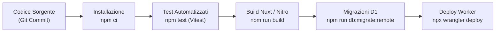

# 02 - Operazioni e DevOps

**Progetto:** `app-calendario-palestra` (Calendario Palestra)  
**Destinatari:** System Administrator, DevOps Engineer, Cloud Administrator  
**Ultimo aggiornamento:** 17/11/2026  
**Referente Infrastruttura / Cloud:** `[DA COMPLETARE: Nome e contatto del responsabile DevOps / amministratore Cloudflare]`

---

## 1. Requisiti e Setup Ambienti

### 1.1 Versioni di Runtime, Strumenti e Servizi Esterni

| Componente | Requisito / Versione nel Progetto | Note Operative |
| :--- | :--- | :--- |
| **Node.js** | `v24.18.1` (Richiesto `>= 22.6.0`) | Necessario il supporto al flag `--experimental-strip-types` utilizzato dagli script `db:seed:local` e `db:seed:remote` in `package.json`. |
| **Package Manager** | `npm 11.16.0` (con `package-lock.json` v3) | Il progetto utilizza `npm` come gestore pacchetti predefinito. |
| **Cloudflare Workers Runtime** | `compatibility_date: "2025-07-15"` | Configurato con flag `["nodejs_compat"]` in `wrangler.jsonc` e preset Nitro `cloudflare-module` in `nuxt.config.ts`. |
| **Wrangler CLI** | `4.160.1` | Installato come dipendenza di sviluppo locale (`npx wrangler`). |
| **Database** | Cloudflare D1 (SQLite) | Nome binding: `DB`, nome database: `app-calendario-palestra-db`. |
| **Drizzle Kit** | `0.31.11` | Generazione migrazioni SQL in `server/db/migrations/`. |
| **Provider Email (Primario)** | **Resend** (`https://api.resend.com/emails`) | Attivato automaticamente se la variabile `RESEND_API_KEY` è valorizzata. |
| **Provider Email (Alternativo)** | **Brevo** (`https://api.brevo.com/v3/smtp/email`) | Attivato automaticamente se `RESEND_API_KEY` è assente e `BREVO_API_KEY` è valorizzata. |
| **Dominio e DNS** | `[DA COMPLETARE: Dominio di produzione .com]` | Richiede configurazione record DNS `SPF`, `DKIM` e `DMARC` sul provider email scelto per evitare che le email finiscano in spam. |

---

### 1.2 Avvio dell'Ambiente di Sviluppo Locale (Passo-Passo)

In ambiente locale, Nuxt 4 integra il modulo `nitro-cloudflare-dev` che simula il runtime Cloudflare Workers e persiste il database SQLite D1 locale nella directory `.wrangler/state/v3`.

1. **Clonazione del repository e installazione dipendenze:**
   ```bash
   git clone [DA COMPLETARE: URL del repository Git]
   cd app-calendario-palestra
   npm install
   ```
   *(Lo script `postinstall` esegue automaticamente `nuxt prepare` per generare i tipi in `.nuxt/`).*

2. **Applicazione delle migrazioni sul database D1 locale:**
   ```bash
   npm run db:migrate:local
   ```
   *(Equivale a: `wrangler d1 migrations apply app-calendario-palestra-db --local`).*

3. **Popolamento iniziale (Seed) del database locale:**
   ```bash
   npm run db:seed:local
   ```
   Lo script [server/db/seed.ts](file:///c:/Users/Damiano/Progetti%20Visual%20Studio%20Code/app-calendario-palestra/server/db/seed.ts) è **idempotente** (`WHERE NOT EXISTS`) e inizializza:
   - L'utente tecnico invisibile `admin@palestra.it` (solo nella tabella `users`).
   - La sede di esempio `Palestra Centrale` con fuso orario `Europe/Rome`.
   - Il Gerente della sede `gerente@palestra.it` associato a `Palestra Centrale` in `users_centers` (`is_manager = 1`).
   *(Le password di sviluppo predefinite sono definite in `DEFAULT_SEED_OPTIONS` dentro `server/db/seed.ts` e possono essere sovrascritte tramite variabili d'ambiente).*

4. **Avvio del server di sviluppo:**
   ```bash
   npm run dev
   ```
   L'applicazione sarà raggiungibile all'indirizzo `http://localhost:3000`. In assenza di `RESEND_API_KEY` e `BREVO_API_KEY`, tutte le email transazionali vengono stampate direttamente nel terminale con prefisso `[Email Dev Console]`.

---

### 1.3 Setup e Provisioning dell'Ambiente di Produzione (Cloudflare)

Per il rilascio in produzione su Cloudflare Workers e Cloudflare D1, seguire rigorosamente i passaggi seguenti:

1. **Autenticazione Wrangler CLI sull'account Cloudflare del cliente:**
   ```bash
   npx wrangler login
   ```

2. **Creazione del database Cloudflare D1 di produzione:**
   ```bash
   npx wrangler d1 create app-calendario-palestra-db
   ```
   Il comando restituirà un identificativo UUID reale (`database_id`).

3. **Aggiornamento di `wrangler.jsonc`:**
   Aprire [wrangler.jsonc](file:///c:/Users/Damiano/Progetti%20Visual%20Studio%20Code/app-calendario-palestra/wrangler.jsonc) e sostituire il segnaposto `00000000-0000-0000-0000-000000000000` con il `database_id` reale restituito da Cloudflare:
   ```jsonc
   "d1_databases": [
     {
       "binding": "DB",
       "database_name": "app-calendario-palestra-db",
       "database_id": "[DA COMPLETARE: UUID del database D1 di produzione]"
       "migrations_dir": "server/db/migrations"
     }
   ]
   ```

4. **Configurazione dei Secrets e delle Variabili su Cloudflare Workers:**
   Impostare i segreti crittografici e le chiavi API sul Worker tramite Wrangler (non salvare mai segreti di produzione in chiaro nei file versionati):
   ```bash
   npx wrangler secret put AUTH_SECRET
   # Inserire una stringa casuale ad alta entropia (es. generata con: openssl rand -base64 48)

   # Se si utilizza Resend:
   npx wrangler secret put RESEND_API_KEY

   # Oppure se si utilizza Brevo:
   npx wrangler secret put BREVO_API_KEY
   ```
   Impostare inoltre le variabili `APP_URL` (es. `https://[DA COMPLETARE: dominio-produzione.com]`) ed `EMAIL_FROM` (es. `Nome Palestra <noreply@[DA COMPLETARE: dominio-produzione.com]>`) tramite dashboard Cloudflare Workers o sezione `"vars"` di `wrangler.jsonc`.

5. **Applicazione delle migrazioni sul database D1 remoto (Produzione):**
   ```bash
   npm run db:migrate:remote
   ```

6. **Esecuzione del Seed iniziale sul database remoto con credenziali personalizzate:**
   Fornire le variabili d'ambiente con le credenziali reali del primo Gerente prima di lanciare il comando:
   ```bash
   # Esempio PowerShell:
   $env:SEED_ADMIN_EMAIL="admin@[DA COMPLETARE: dominio.com]"
   $env:SEED_ADMIN_PASSWORD="[DA COMPLETARE: Password sicura Admin]"
   $env:SEED_CENTER_NAME="[DA COMPLETARE: Nome Sede Reale]"
   $env:SEED_MANAGER_EMAIL="[DA COMPLETARE: Email Gerente Reale]"
   $env:SEED_MANAGER_PASSWORD="[DA COMPLETARE: Password Iniziale Gerente]"
   npm run db:seed:remote
   ```

7. **Build e Deploy su Cloudflare Workers:**
   ```bash
   npm run build
   npx wrangler deploy
   ```

---

## 2. Pipeline CI/CD e Deploy

### 2.1 Stato Attuale nel Repository
All'interno del repository **non sono presenti** file di pipeline CI/CD preconfigurati (`.github/workflows/*`, `.gitlab-ci.yml`), né file di containerizzazione (`Dockerfile`, `docker-compose.yml`), in quanto l'architettura target è **Serverless Edge** nativa su Cloudflare Workers.

- **Piattaforma CI/CD Aziendale Scelta:** `[DA COMPLETARE: Indicare se il deploy avverrà tramite GitHub Actions, GitLab CI, Cloudflare Workers Builds o rilascio manuale da CLI]`

### 2.2 Flusso di Build, Verifica e Rilascio



1. **Generazione Nuove Migrazioni (solo in caso di modifiche a `server/db/schema.ts`):**
   ```bash
   npm run db:generate
   ```
   Genera un nuovo file `.sql` incrementale e aggiorna lo snapshot in `server/db/migrations/meta/`.
2. **Esecuzione Suite di Test (Gate di Qualità):**
   ```bash
   npm test
   ```
   Esegue `vitest run` verificando tutti i 45 test su fusi orari, schemi Zod, calcoli di dominio, autenticazione, CRUD, code e flussi cliente.
3. **Compilazione per Cloudflare Workers:**
   ```bash
   npm run build
   ```
   Compila il frontend Vue e il server Nitro usando il preset `cloudflare-module`, generando l'artefatto pronto per il deploy nella cartella `.output/`.
4. **Anteprima Locale della Build di Produzione:**
   ```bash
   npm run preview
   ```
5. **Pubblicazione su Cloudflare:**
   ```bash
   npx wrangler deploy
   ```

---

## 3. Variabili d'Ambiente e Binding

L'applicazione risolve le variabili d'ambiente tramite l'helper `getCloudflareEnv(event)` definito in [server/utils/db.ts](file:///c:/Users/Damiano/Progetti%20Visual%20Studio%20Code/app-calendario-palestra/server/utils/db.ts), con fallback automatico su `process.env` per gli ambienti Node/test.

### 3.1 Binding e Variabili Runtime dell'Applicazione

| Nome Variabile / Binding | Tipo | Obbligatorietà | Valore di Default / Fallback nel Codice | Esempio Sicuro | Descrizione e Impatto |
| :--- | :--- | :--- | :--- | :--- | :--- |
| `DB` | Binding Cloudflare D1 | **Obbligatorio** | Nessuno (restituisce HTTP `500` se assente) | Configurato in `wrangler.jsonc` | Istanza del database SQLite Cloudflare D1 utilizzata da Drizzle ORM. |
| `AUTH_SECRET` | Secret / Stringa | **Obbligatorio in Produzione** | `'dev-palestra-secret-change-in-production-2026-cloudflare'` (solo per sviluppo locale) | `K9x!mP2$vL8@qR5#zW1...` (min. 32 byte casuali) | Chiave segreta HMAC-SHA256 usata per firmare e verificare il cookie di sessione `palestra_session` e i token stateless di recupero password (validi 30 min). |
| `APP_URL` | Variabile / Stringa | **Consigliato in Produzione** | Derivato dinamicamente da `getRequestURL(event)` o `'http://localhost:3000'` | `https://calendario.esempio-palestra.com` | URL base pubblico dell'applicazione utilizzato per comporre i link nelle email transazionali (`/login` e `/recover?token=...`). |
| `RESEND_API_KEY` | Secret / Stringa | Condizionale (Alternativo a Brevo) | `undefined` | `re_123456789_abcdefghijklmnop` | API Key per l'invio di email tramite **Resend** (`https://api.resend.com/emails`). Ha priorità su Brevo se entrambi sono configurati. |
| `BREVO_API_KEY` | Secret / Stringa | Condizionale (Alternativo a Resend) | `undefined` | `xkeysib-1234567890abcdef...` | API Key per l'invio di email tramite **Brevo** (`https://api.brevo.com/v3/smtp/email`). Usato se `RESEND_API_KEY` non è impostato. |
| `EMAIL_FROM` | Variabile / Stringa | **Consigliato in Produzione** | `'Palestra <noreply@palestra.com>'` | `'Centro Yoga Rossi <noreply@centroyogarossi.com>'` | Mittente delle email transazionali. Supporta il formato `Nome <indirizzo@dominio.com>` o solo indirizzo email. Deve appartenere al dominio verificato su Resend/Brevo. |
| `NODE_ENV` | Variabile / Stringa | Opzionale | `'development'` / `'production'` | `production` | Se impostato a `'production'`, abilita il flag `Secure` sul cookie HTTP-only `palestra_session` ([server/utils/auth.ts](file:///c:/Users/Damiano/Progetti%20Visual%20Studio%20Code/app-calendario-palestra/server/utils/auth.ts#L139-L147)). Se `'test'`, silenzia i log console delle email. |

### 3.2 Variabili d'Ambiente CLI per lo Script di Seed (`server/db/seed.ts`)

Queste variabili sono lette esclusivamente durante l'esecuzione da riga di comando di `npm run db:seed:local` o `npm run db:seed:remote`:

| Nome Variabile | Obbligatorietà | Default nel Codice (`seed.ts`) | Esempio Sicuro | Descrizione |
| :--- | :--- | :--- | :--- | :--- |
| `D1_DATABASE_NAME` | Opzionale | `'app-calendario-palestra-db'` | `app-calendario-palestra-db` | Nome del database D1 target passato a `wrangler d1 execute`. |
| `SEED_ADMIN_EMAIL` | Opzionale | `'admin@palestra.it'` | `admin@dominio-cliente.com` | Email dell'account tecnico `admin` invisibile. |
| `SEED_ADMIN_PASSWORD` | **Obbligatorio cambiare in Prod** | Definita in `DEFAULT_SEED_OPTIONS` | `[Generare password complessa]` | Password iniziale dell'account `admin` (salvata come hash PBKDF2-SHA256). |
| `SEED_CENTER_NAME` | Opzionale | `'Palestra Centrale'` | `Studio Pilates Milano` | Nome della prima sede creata dallo script di seed. |
| `SEED_MANAGER_EMAIL` | Opzionale | `'gerente@palestra.it'` | `direzione@dominio-cliente.com` | Email del Gerente iniziale della sede. |
| `SEED_MANAGER_PASSWORD` | **Obbligatorio cambiare in Prod** | Definita in `DEFAULT_SEED_OPTIONS` | `[Generare password complessa]` | Password di primo accesso del Gerente iniziale. |

---

## 4. Runbook Operativo

### 4.1 Procedure di Backup e Ripristino (Cloudflare D1)

#### Backup Manuale (Esportazione SQL)
Per esportare un dump completo (schema + dati) del database D1 di produzione in un file `.sql`:
```bash
npx wrangler d1 export app-calendario-palestra-db --remote --output=backup-palestra-$(date +%Y%m%d).sql
```

#### Ripristino da Point-in-Time (Cloudflare D1 Time Travel)
Cloudflare D1 include nativamente la funzionalità **Time Travel**, che consente di ripristinare il database a qualsiasi minuto degli ultimi 30 giorni (su piano Workers Paid) o 7 giorni (su piano Free):
1. Verificare il bookmark corrispondente a un timestamp specifico:
   ```bash
   npx wrangler d1 time-travel info app-calendario-palestra-db --timestamp="2026-11-17T12:00:00Z"
   ```
2. Eseguire il ripristino allo stato desiderato:
   ```bash
   npx wrangler d1 time-travel restore app-calendario-palestra-db --timestamp="2026-11-17T12:00:00Z"
   ```

#### Ripristino da File di Dump SQL
```bash
npx wrangler d1 execute app-calendario-palestra-db --remote --file=backup-palestra-YYYYMMDD.sql
```

---

### 4.2 Posizione dei Log e Monitoraggio

- **Ambiente Locale:**
  - I log applicativi e le email simulate (`[Email Dev Console]`) sono emessi sullo standard output (`stdout` / `stderr`) del terminale in cui è attivo `npm run dev`.
  - Lo stato locale di SQLite D1 e di Wrangler è persistito nella cartella `.wrangler/state/v3` (configurata in `nuxt.config.ts`).
- **Ambiente di Produzione (Cloudflare Workers):**
  - **Streaming in tempo reale da CLI:**
    ```bash
    npx wrangler tail app-calendario-palestra
    ```
  - **Dashboard Web:** Cloudflare Dashboard → *Workers & Pages* → `app-calendario-palestra` → scheda *Logs* / *Real-time Logs*.
  - Gli errori di invio email tramite Resend o Brevo vengono registrati con `console.error('[Email] Invio tramite Resend/Brevo fallito (<status>): <dettaglio>')` in [server/utils/email.ts](file:///c:/Users/Damiano/Progetti%20Visual%20Studio%20Code/app-calendario-palestra/server/utils/email.ts).

---

### 4.3 Controlli di Stato (Health Check)

Non esiste un endpoint dedicato `/api/health`, ma è possibile verificare lo stato dell'applicazione e del runtime tramite i seguenti controlli:

1. **Verifica raggiungibilità Frontend SSR (`HTTP 200`):**
   ```bash
   curl -I https://[DA COMPLETARE: dominio-produzione.com]/login
   ```
2. **Verifica reattività Middleware Nitro (`HTTP 401` atteso senza cookie):**
   ```bash
   curl -i https://[DA COMPLETARE: dominio-produzione.com]/api/auth/me
   # Risposta attesa: HTTP/2 401 {"statusCode":401,"message":"Autenticazione richiesta."}
   ```
3. **Verifica Connettività Database D1:**
   ```bash
   npx wrangler d1 execute app-calendario-palestra-db --remote --command="SELECT COUNT(*) AS active_centers FROM centers WHERE deleted_at IS NULL;"
   ```

---

### 4.4 Risoluzione dei Problemi Comuni (Troubleshooting)

| Sintomo / Messaggio di Errore | Causa Probabile | Soluzione Operativa |
| :--- | :--- | :--- |
| **HTTP 500:** `"Database D1 non configurato nell'ambiente Cloudflare."` | Il binding `DB` non è associato al Worker o `wrangler.jsonc` punta a un `database_id` errato. | Verificare il blocco `d1_databases` in `wrangler.jsonc` e controllare su Cloudflare Dashboard → Worker → *Settings* → *Bindings* che il database D1 sia collegato con nome variabile esatto `DB`. |
| **Tutti gli utenti vengono disconnessi improvvisamente (`401 Sessione non valida o scaduta`)** | La variabile `AUTH_SECRET` è stata modificata o rimossa. | Verificare che `AUTH_SECRET` sia stabile tra i deploy. Nota: la rotazione di `AUTH_SECRET` invalida intenzionalmente tutte le sessioni attive e i token di recupero in corso. |
| **Le email non arrivano ai destinatari (ma l'operazione sul DB ha successo)** | 1) Né `RESEND_API_KEY` né `BREVO_API_KEY` sono configurate (il sistema usa il fallback console).<br>2) Il dominio in `EMAIL_FROM` non ha record SPF/DKIM verificati sul provider email. | Avviare `npx wrangler tail` durante un'azione che invia email (es. recupero password). Se compare `[Email Dev Console]`, configurare la API Key del provider; se compare `[Email] Invio tramite Resend/Brevo fallito`, verificare la chiave API e la verifica del dominio mittente (`EMAIL_FROM`). |
| **I link nelle email di recupero password o benvenuto puntano a un dominio errato** | La variabile `APP_URL` non è impostata o contiene un URL obsoleto. | Configurare `APP_URL` con l'URL pubblico definitivo (senza slash finale, es. `https://app.palestra.com`). |
| **Errore in fase di creazione lezioni ricorrenti:** `"L'orario locale ... non esiste nel fuso orario ... a causa del passaggio all'ora legale (DST)"` | Una delle date ricorrenti cade esattamente nell'ora "saltata" durante il passaggio primaverile all'ora legale (es. le `02:30` dell'ultima domenica di marzo in `Europe/Rome`). | Comportamento corretto per prevenire timestamp ambigui. Scegliere un orario valido o suddividere l'intervallo di date. |
| **Impossibile aggiungere una nuova sede (`centers`) dall'interfaccia web** | Come da specifica (`SPECIFICATION.md`), la creazione di nuove sedi e dei relativi Gerenti è riservata all'utente `admin` a livello database. | Eseguire lo script di seed con variabili personalizzate (`SEED_CENTER_NAME`, `SEED_MANAGER_EMAIL`, `npm run db:seed:remote`) oppure inserire la nuova sede tramite `npx wrangler d1 execute`. |
